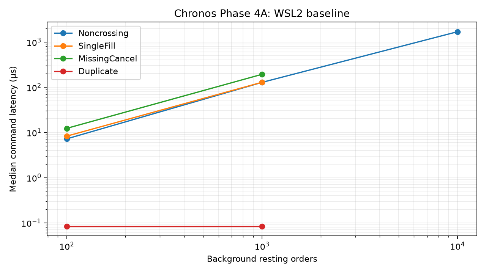

# Phase 4A benchmark report

## Environment and scope

Measured on 2026-11-12 in Ubuntu 24.04.1 under WSL2, Linux `6.6.87.2-microsoft-standard-WSL2`, on a 13th Gen Intel Core i7-13620H. The VM reported 16 logical CPUs and 7.6 GiB RAM; Microsoft hypervisor was present. GCC 13.3.0, CMake 3.28.3 and Google Benchmark 1.8.3 were used. The CMake Release build used `-O3 -DNDEBUG -std=c++20`; workloads were single-threaded, unpinned, and ran on a shared host. These are **in-process simulator command measurements**, not network or production-hardware latency. No source optimization was made.

The [methodology](phase4-benchmark-methodology.md) defines workloads, timing boundaries, exact reproduction commands, reset and verification. Each table row pools 192 individual observations (64 samples × 3 independently populated repetitions). Background size excludes any one or eight workload-specific resting orders. Values are microseconds; rate is 1 / mean measured command time, not concurrent throughput. p99 is included for transparency but is based on only about two samples beyond the quantile and is not a reliable tail estimate. The short duplicate/empty timings are particularly sensitive to clock and harness overhead. Reset values include verification and are **not included** in command latency or rate.

## Measurements

| Workload | Background orders | Samples | p50 µs | p95 µs | p99 µs | Commands/s | Reset + verify p50 µs |
|---|---:|---:|---:|---:|---:|---:|---:|
| Empty market | 0 | 192 | 0.144 | 0.232 | 0.430 | 6,188,159 | 0.072 |
| Noncrossing | 100 | 192 | 7.210 | 7.619 | 13.144 | 136,641 | 7.429 |
| Noncrossing | 1,000 | 192 | 128.069 | 189.588 | 369.009 | 7,381 | 126.023 |
| Noncrossing | 10,000 | 192 | 1,684.330 | 2,457.970 | 2,827.400 | 553 | 1,702.790 |
| Single fill | 100 | 192 | 8.281 | 13.317 | 23.834 | 115,284 | 8.109 |
| Single fill | 1,000 | 192 | 128.665 | 153.228 | 266.172 | 7,558 | 126.275 |
| Eight fills, same price | 100 | 192 | 8.692 | 14.024 | 36.609 | 103,536 | 61.369 |
| Eight fills, same price | 1,000 | 192 | 131.905 | 217.685 | 503.867 | 6,938 | 1,003.460 |
| Eight-level sweep | 100 | 192 | 11.129 | 17.292 | 44.148 | 82,044 | 74.875 |
| Eight-level sweep | 1,000 | 192 | 137.503 | 198.862 | 278.054 | 7,058 | 1,050.840 |
| Cancel | 100 | 192 | 12.154 | 15.825 | 52.221 | 83,508 | 11.980 |
| Cancel | 1,000 | 192 | 127.741 | 173.243 | 206.293 | 7,723 | 126.754 |
| Reduce quantity | 100 | 192 | 7.369 | 13.021 | 25.246 | 117,825 | 7.458 |
| Reduce quantity | 1,000 | 192 | 126.915 | 204.028 | 489.154 | 7,104 | 125.877 |
| Increase quantity | 100 | 192 | 11.672 | 15.123 | 16.601 | 88,355 | 11.778 |
| Increase quantity | 1,000 | 192 | 129.966 | 227.032 | 473.263 | 6,355 | 115.110 |
| Change price | 100 | 192 | 7.411 | 9.412 | 34.967 | 125,453 | 7.423 |
| Change price | 1,000 | 192 | 121.052 | 198.011 | 272.005 | 7,534 | 129.263 |
| Duplicate rejection | 100 | 192 | 0.084 | 0.111 | 0.224 | 10,812,637 | 0.117 |
| Duplicate rejection | 1,000 | 192 | 0.084 | 0.116 | 0.278 | 11,080,332 | 0.121 |
| Missing cancellation | 100 | 192 | 12.314 | 13.948 | 16.669 | 87,107 | 0.166 |
| Missing cancellation | 1,000 | 192 | 192.849 | 262.662 | 322.899 | 5,582 | 0.313 |

The eight-order resets require eight untimed submissions and are materially more expensive than the timed sweep itself. Noncrossing setup including three warmups took 0.480–0.504 ms at 100 background orders, 60.9–65.0 ms at 1,000, and 8.14–8.47 seconds at 10,000 per repetition. The 10,000-order noncrossing run took 25.24 seconds wall time in total. Other 10,000-order cases and all registered 100,000-order cases were not run because full initialization through clone-on-submit is expensive; there are no measurements for those cases.

## Allocation, memory and profiling

A separate instrumented probe counted the following scalar C++ `new` calls and requested bytes for one verified command per case. It does not count all allocation paths or measure live memory; it is not used for latency.

| Workload | Background orders | Calls | Requested bytes |
|---|---:|---:|---:|
| Duplicate rejection | 100 / 1,000 | 1 / 1 | 32 / 32 |
| Missing cancellation | 100 / 1,000 | 207 / 2,010 | 12,504 / 121,360 |
| Noncrossing | 100 / 1,000 | 212 / 2,015 | 12,776 / 121,632 |
| Single fill | 100 / 1,000 | 211 / 2,014 | 12,784 / 121,640 |

Process-wide maximum RSS was 4,608 KiB for the combined 0/100/1,000 run and 7,088 KiB for the separate 10,000 noncrossing run. These include the benchmark process, setup and restoration, and are not incremental per-command peaks. No allocation totals were collected for 10,000 or 100,000 orders.

`perf`, Valgrind and heaptrack were not available. A separate gprof-instrumented 1,000-order noncrossing run captured setup and restoration as well as timed calls. Its flat profile had only 0.09 seconds of sampled time and implausibly attributes calls to fill code even though the workload does not cross; optimized attribution and library coverage are therefore inadequate for a trustworthy hotspot ranking. The profile is retained rather than used as proof of a specific cost distribution.

## Interpretation and Phase 4B

Noncrossing median latency rose from 7.210 µs at 100 to 128.069 µs at 1,000 and 1,684.330 µs at 10,000 background orders. The matching engine clones the book for these commands. The probe independently shows scalar allocation count growing from 212 to 2,015 between 100 and 1,000 orders, while duplicate rejection—which returns before cloning—stayed at one allocation and 0.084 µs median. Missing cancellation also clones and rises from 207 to 2,010 allocations. Together, those measurements and the inspected code implicate clone-related work and allocation churn as a major scaling bottleneck in these workloads; they do not establish the percentage spent in allocation versus copying, hashing, destruction, or output construction. WSL scheduling and 192 samples limit conclusions about tails and small differences.

Phase 4B should first repeat on isolated native Linux with more samples and reliable CPU/heap profiling, varied book shapes and operation mixes. Then prototype a prevalidated plan or bounded undo journal only after specifying no-throw commit, rollback and event sequencing; compare against this clone-based correctness reference and repeat allocation-failure and deterministic replay tests. The [performance plan](phase4-performance-plan.md) records the tradeoffs. No performance optimization is implemented here.

## Artifacts and checks

- [Summary CSV](assets/phase4/summary.csv), [raw 0/100/1,000 samples](assets/phase4/samples-final.csv), [raw 10,000 samples](assets/phase4/samples-10000-final.csv), [allocation counts](assets/phase4/allocations.csv).
- [Google Benchmark JSON](assets/phase4/results-final.json), [10,000 JSON](assets/phase4/results-10000-final.json), [process timing](assets/phase4/time-final.txt), [10,000 process timing](assets/phase4/time-10000-final.txt), [gprof output](assets/phase4/gprof.txt).
- Debug, Release and ASan/UBSan each passed **38/38** existing CTest cases. The benchmark harness verifies every operation and restored state outside its measured interval. Formatting and tracked Git whitespace checks passed.
