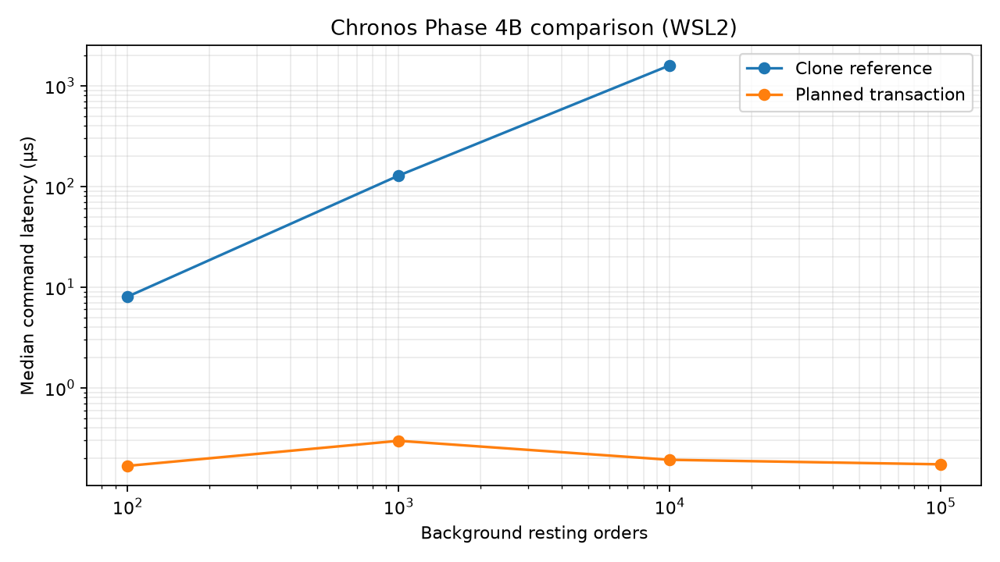

# Phase 4B transaction optimization report

## Implementation and safety

The default matching engine now stages a price-time execution plan and all reports/trades before mutating its existing book. It checks counters, revision capacity and remainder aggregate, then inserts any remainder with the book's strong exception guarantee. After that first mutation, a private `noexcept` primitive consumes existing best heads without allocations or callbacks; counters and the movable outcome are committed without throwing. Book maintenance uses the existing rollback-safe operations directly. The public stale-selection API remains revision-bound. The original full clone path is retained as `TransactionMode::CloneReference` and can be selected with `CHRONOS_TRANSACTION_MODE=reference` in benchmarks. See [design and proof obligations](phase4-optimization-design.md) for alternatives, iterator lifetime, failure ordering and limitations.

The planned path visits the affected price-time prefix instead of copying unrelated orders. It has expected `O(F)` work and output space for `F` fills, plus `O(log P)` level lookup/insertion where needed; hash rehashes or collisions can cost more. The clone reference visits all `N` orders and requires `O(N + P)` extra book storage. These are algorithmic bounds, not latency claims.

## Measurement methodology

Both modes used the **same executable and workload definitions** from [Phase 4A](phase4-benchmark-methodology.md), with separate fresh engines, three warmups and three repetitions of 64 samples per workload/size. `benchmarks/run_comparison.sh` alternates mode order by size: reference then planned at 100, planned then reference at 1,000, reference then planned at 10,000; it also runs planned at 100,000. Each raw sample records command and separate restoration-plus-verification time. Inputs are deterministic; no random numbers are used by the benchmark. Command timing excludes population, verification and reset. Peak RSS from `/usr/bin/time -v` includes the entire process and setup. [Comparison CSV](assets/phase4/4b/comparison.csv) contains all raw-derived mean, p50, p95, descriptive p99 and serial rates for every measured workload/size, including 100, 1,000, 10,000 and planned-only 100,000. [Raw outputs](assets/phase4/4b/) include individual samples, JSON, allocation counts and process measurements.

Runs were on the same WSL2 Ubuntu 24.04.1 VM, Linux 6.6.87.2, 13th Gen Intel Core i7-13620H, 16 visible logical CPUs, GCC 13.3.0 and CMake 3.28.3, with `-O3 -DNDEBUG`, Google Benchmark 1.8.3, single-threaded and unpinned. These are simulator-internal timings, not network or production-trading latency. Every row pools 192 observations; p99 depends on roughly two high observations and is descriptive, not a dependable tail estimate. Many planned operations approach clock and harness overhead, so large ratios and small differences are especially approximate. Serial rate is the inverse mean measured command latency, not concurrent throughput.

To reproduce with a **new, empty** output directory, first build `chronos_bench` and `chronos_allocation_probe` as in the Phase 4A methodology, then run:

```sh
bash benchmarks/run_comparison.sh docs/assets/phase4/my-4b
python3 benchmarks/summarize.py docs/assets/phase4/my-4b/reference-{100,1000,10000}.samples.csv --output docs/assets/phase4/my-4b/reference-summary.csv
python3 benchmarks/summarize.py docs/assets/phase4/my-4b/planned-{100,1000,10000,100000}.samples.csv --output docs/assets/phase4/my-4b/planned-summary.csv
python3 benchmarks/compare.py docs/assets/phase4/my-4b/reference-summary.csv docs/assets/phase4/my-4b/planned-summary.csv --output docs/assets/phase4/my-4b/comparison.csv
```

The script refuses to overwrite its raw result files, validates JSON errors and sample counts, and runs the clone 10,000 matrix for several minutes on the measured host. Add `--plot path.png` to the last command if matplotlib is available.

## Matched results at 1,000 background orders

Each pair is clone reference / planned. Times are microseconds; speedup is reference p50 divided by planned p50.

| Workload | Mean µs | p50 µs | p95 µs | p99 µs | Commands/s | p50 ratio |
|---|---:|---:|---:|---:|---:|---:|
| Noncrossing | 148.901 / 0.320 | 128.141 / 0.298 | 229.894 / 0.414 | 307.914 / 0.826 | 6,716 / 3,129,125 | 430.0x |
| Single fill | 132.131 / 0.288 | 119.425 / 0.263 | 188.398 / 0.327 | 259.845 / 0.693 | 7,568 / 3,473,102 | 454.1x |
| Eight fills, same price | 154.108 / 1.293 | 132.306 / 1.239 | 238.445 / 1.753 | 311.451 / 2.366 | 6,489 / 773,679 | 106.8x |
| Eight-level sweep | 158.992 / 1.656 | 143.000 / 1.706 | 242.508 / 1.977 | 280.700 / 2.286 | 6,290 / 603,730 | 83.8x |
| Cancel | 158.228 / 0.166 | 142.018 / 0.151 | 239.986 / 0.195 | 343.485 / 0.491 | 6,320 / 6,041,155 | 940.5x |
| Reduce | 137.827 / 0.084 | 126.261 / 0.081 | 211.298 / 0.101 | 281.484 / 0.347 | 7,255 / 11,868,702 | 1,558.8x |
| Increase | 129.972 / 0.080 | 120.351 / 0.076 | 190.051 / 0.087 | 323.708 / 0.159 | 7,694 / 12,526,913 | 1,583.6x |
| Reprice | 157.733 / 0.242 | 139.692 / 0.212 | 233.391 / 0.340 | 378.251 / 0.652 | 6,340 / 4,138,199 | 658.9x |
| Duplicate rejection | 0.095 / 0.108 | 0.083 / 0.102 | 0.118 / 0.133 | 0.418 / 0.335 | 10,561,637 / 9,274,914 | 0.8x |
| Missing cancellation | 124.278 / 0.093 | 114.635 / 0.093 | 183.497 / 0.114 | 228.885 / 0.272 | 8,046 / 10,725,059 | 1,232.6x |

Empty-book market, at zero background orders, measured reference/planned p50 **0.167 / 0.107 µs** (1.6x); mean **0.227 / 0.125 µs** and serial rate **4,413,387 / 8,000,667 commands/s**. At 10,000 background orders, noncrossing p50 was **1,591.850 / 0.193 µs**, and eight-level sweep p50 was **1,470.200 / 1.014 µs**. At 100,000, the planned noncrossing p50 was **0.174 µs**, but there is no reference measurement or speedup at that size. The reference 100,000 setup was omitted because it repeatedly clones the growing book; the full reference 10,000 matrix took 3:48.64 wall time. The small apparent duplicate regression is close to timing overhead and should not be generalized from this sample.



## Allocation, memory and profiling

The separate scalar-`new` probe measured the following single-command counts/bytes (reference → planned), independent of latency timing:

| Workload | Background | Calls | Requested bytes |
|---|---:|---:|---:|
| Duplicate | 100 / 1,000 | 1 → 1 / 1 → 1 | 32 → 32 / 32 → 32 |
| Missing cancellation | 100 / 1,000 | 207 → 0 / 2,010 → 0 | 12,504 → 0 / 121,360 → 0 |
| Noncrossing | 100 / 1,000 | 212 → 5 / 2,015 → 5 | 12,776 → 272 / 121,632 → 272 |
| Single fill | 100 / 1,000 | 211 → 4 / 2,014 → 4 | 12,784 → 280 / 121,640 → 280 |

Counts exclude aligned and direct C allocations and do not measure live or peak bytes. Process-wide peak RSS for the 1,000 matrix was **4,608 KiB reference / 4,480 KiB planned**; at 10,000 it was **6,912 / 5,504 KiB**. Planned-only 100,000 was **18,132 KiB**. These numbers include setup, verification, reset, runtime and measurement infrastructure, not per-command incremental peaks. The reference 100,000 run was not performed.

`perf`, Valgrind and heaptrack were unavailable. A separate `-O2 -g -pg` planned-mode gprof run for noncrossing/1,000 reported no accumulated sampled time and implausibly attributed calls to fill code; it includes setup/reset and does not instrument shared libraries. It cannot establish a trustworthy hotspot ranking. Allocation counts and same-binary timing support the conclusion that removing whole-book cloning reduced work on these selected workloads; they do not apportion the improvement among allocation, copying, hashing and destruction.

## Verification and remaining work

Debug, Release and ASan/UBSan each passed **41/41** CTest cases, including the original 38, fixed-seed 1,000-command differential comparison, counter/aggregate boundaries and allocation-failure tests. The differential test compares trades, reports, counters, level aggregates and FIFO state; scalar `new` failure injection covers preparation and remainder insertion, but is not a formal proof of all allocator/library failure modes. No benchmark workload reported an error. Formatting and Git whitespace checks passed; the CLI demo completed. No network, persistence, risk, self-trade prevention or durable publication was added.

The final review expanded the suite to **43 tests**, with **43/43 passing** in each of Debug, Release and ASan/UBSan. The added differential case exercises staged remainders and multi-level fills across increasing index sizes; the added allocation-failure case exercises a complete multi-fill command that returns while the next scalar allocation is configured to fail. These complement, but do not turn, the private `noexcept` commit's invariant reasoning into a formal proof.

Final-review representative benchmark reruns in both modes reported no workload errors. For noncrossing at 1,000 background orders, the median of the three per-repetition p50s was **135.480 µs reference / 0.195 µs planned**; for an eight-level sweep at 100 it was **10.452 / 1.059 µs**. These are separate smoke runs rather than replacements for the pooled measurements above, and retain the same WSL2, clock-overhead and sample-size limitations.

Phase 5 should define durable event/command sequencing and atomic publication, exchange-level cancellation/replace semantics, and integration boundaries before adding services. Independently repeat performance work on isolated native Linux with longer runs and reliable CPU/heap profilers, more book shapes and contention-free controls. The `noexcept` commit assumes serialized access and intact book invariants; violating an internal precondition is not recoverable by rollback. The clone reference duplicates some matching logic and must be kept in sync when semantics change.
